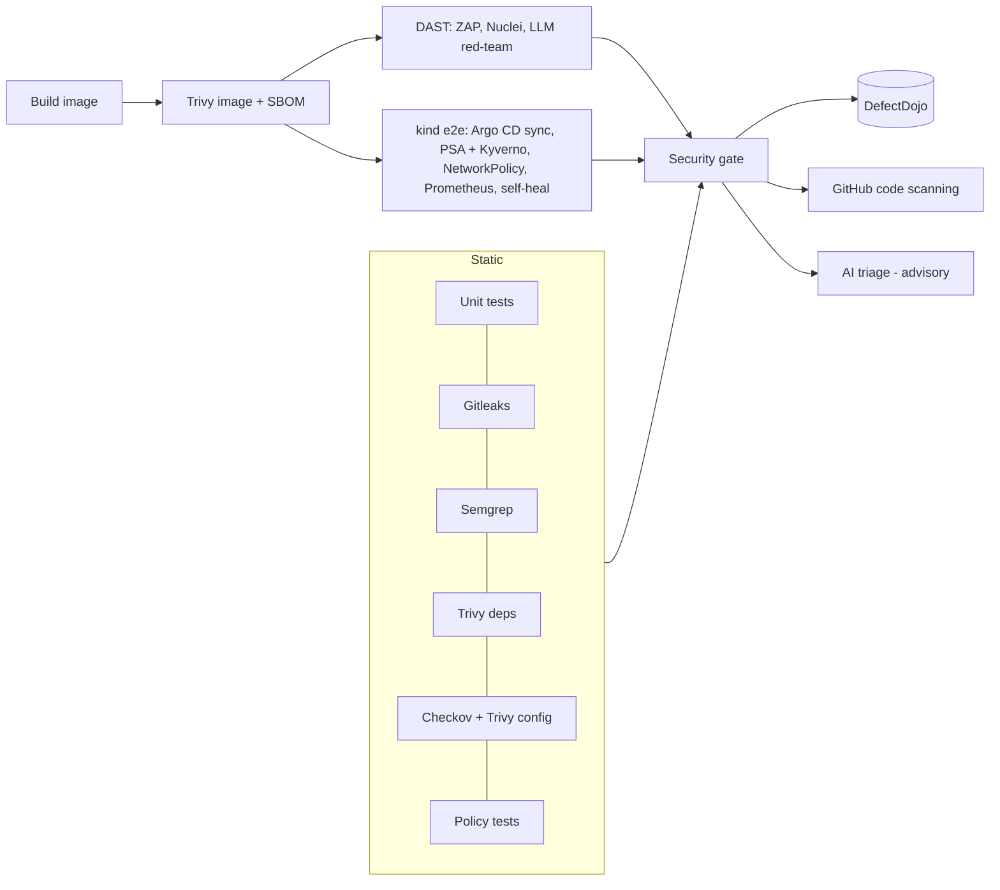

# DevSecOps platform for an LLM service

[](https://github.com/Golovastik777/devsecops-platform/actions/workflows/devsecops.yml)

Secure delivery pipeline, runtime protection and vulnerability management for **kb-assistant**:
a player-support assistant for an online gaming platform that answers questions from a
knowledge base with retrieval-augmented generation (RAG) and Claude.

The service is small on purpose. The point of the repository is everything around it:
how an LLM application is scanned, tested, admitted to Kubernetes, watched at runtime
and how its findings are triaged.

## What is covered

| Area | Tools | Where |
|---|---|---|
| Secret scanning (full git history) | Gitleaks | `ci/scan-secrets.sh` |
| SAST + custom LLM rules | Semgrep (community rulesets + own rules with tests) | `ci/scan-sast.sh`, `security/semgrep/` |
| Dependency scanning (SCA), hash-locked deps | Trivy, `pip --require-hashes` | `ci/scan-deps.sh`, `app/requirements.txt` |
| Image scanning + SBOM | Trivy (vulns, secrets), CycloneDX | `ci/build-image.sh` |
| IaC / misconfiguration scanning | Checkov, Trivy config (tfsec engine) | `ci/scan-iac.sh` |
| DAST and scanning of a running instance | OWASP ZAP baseline, Nuclei (community + own templates) | `ci/dast.sh`, `security/nuclei/` |
| LLM security testing | Prompt-injection red-team suite, Nuclei guardrail template | `security/llm-redteam/` |
| Kubernetes admission | Pod Security Admission `restricted`, Kyverno policies with unit tests | `deploy/k8s/`, `security/kyverno/` |
| Kubernetes isolation | Least-privilege RBAC, default-deny NetworkPolicies | `deploy/k8s/base/` |
| GitOps | Argo CD: restricted AppProject, auto-sync with prune and self-heal | `deploy/argocd/` |
| Monitoring and alerting | Prometheus Operator: app metrics, ServiceMonitor, PrometheusRule with promtool unit tests | `deploy/k8s/base/`, `deploy/k8s/tests/` |
| Runtime detection | Falco rules | `deploy/falco/` |
| Security monitoring | Wazuh rules for app guardrail events and Falco alerts | `deploy/wazuh/`, `infra/ansible/roles/wazuh_agent` |
| Infrastructure | Terraform: AWS, Hetzner, DigitalOcean | `infra/terraform/` |
| Host hardening | Ansible, CIS-inspired baseline | `infra/ansible/` |
| Vulnerability management | DefectDojo import, security gate, time-limited exceptions | `ci/upload_defectdojo.py`, `ci/security_gate.py`, `.security/` |
| AI-assisted triage | Claude agent with read-only code tools | `triage/ai_triage.py` |
| CI systems | GitHub Actions (runs here), GitLab CI, Jenkins | `.github/workflows/`, `.gitlab-ci.yml`, `Jenkinsfile` |

## Pipeline



All three CI systems call the same `ci/*.sh` scripts; scanner versions are pinned once in
`ci/lib.sh`. A tool runs from `PATH` if installed, otherwise from its pinned container image,
so the pipeline also runs on a laptop with only Docker (`make scan`).
GitHub Actions are pinned to commit SHAs, jobs get `contents: read` by default, and only
the gate job can write to code scanning.

### Security gate

`ci/security_gate.py` normalises every report into one finding model and applies
`.security/policy.yaml`:

* CRITICAL and HIGH findings block the merge.
* Any failed IaC check blocks. A check that does not apply is skipped next to the resource
  with a written reason (`#checkov:skip=...`, `#trivy:ignore:...`, `.trivyignore.yaml`).
* Dependency and image CVEs **without a released fix** are reported and tracked, not blocking.
* Temporary exceptions live in `.security/accepted-risks.yaml` and need an owner, a reason
  and an expiry date of at most 90 days. Expired or incomplete exceptions fail the gate.

Outputs: `findings.json` (for DefectDojo and triage), `security.sarif` (code scanning),
`security-summary.md` (job summary).

## LLM security

The assistant is protected in layers, because no single filter stops prompt injection:

1. **Access control at retrieval.** Every knowledge-base document declares an audience.
   Public callers never get internal chunks into the model context, so no prompt can talk
   the model into leaking them. Staff access uses a separate token (constant-time compare).
2. **Input rail.** Heuristic detector for instruction override, prompt exfiltration,
   role hijacking, chat-template tokens, Russian-language variants and obfuscation
   (zero-width and fullwidth characters are normalised first).
3. **Moderation rail (optional).** Llama Guard via an Ollama endpoint, fail-closed by default.
4. **Retrieval rail.** Retrieved text is untrusted: instruction-like lines are removed before
   they reach the model. `app/kb/bonus-terms.md` contains a planted indirect injection to prove it.
5. **Output rail.** A per-process canary token sits in the system prompt; an answer that
   contains it is blocked as a prompt leak. Secrets and card numbers (Luhn-checked) are redacted.
6. **Model side.** Retrieved passages are wrapped as data, the system prompt states they are
   untrusted, and refusals map to a safe answer.

Every block is written as a JSON security event and picked up by Wazuh
(`deploy/wazuh/local_rules.xml` raises an alert on 5+ blocked prompts from one client per minute).

`security/llm-redteam/` is a regression suite run against the live container in CI:
19 attacks across 6 categories must be blocked and 7 legitimate questions must pass.
Three paraphrased or short-encoded attacks are recorded as **known gaps** of the heuristic
layer: they are reported, not hidden, and they are the reason the Llama Guard rail exists.

Own Semgrep rules check LLM-specific code risks: model output reaching `eval`/shell
(OWASP LLM05), LLM calls without a system prompt, exposed FastAPI docs, disabled TLS verification.

## Kubernetes

* Namespace enforces Pod Security Admission `restricted`.
* Deployment: non-root UID 10001, read-only root filesystem, all capabilities dropped,
  seccomp `RuntimeDefault`, no service-account token, resource limits, probes.
  Secrets are mounted as files, never as environment variables.
* Kyverno policies (`Enforce`): no privileged containers or escalation, non-root, read-only
  rootfs, drop ALL, no host namespaces or hostPath, trusted registry, no `:latest`,
  requests/limits. Each rule has a passing and a failing fixture (`kyverno test`, 18 cases).
* The kind e2e job installs kube-prometheus-stack, Argo CD and Kyverno, lets Argo CD sync the
  tested commit, then proves that:
  * every insecure fixture is rejected at admission (PSA catches the baseline violations,
    Kyverno the organisation rules PSA does not cover);
  * the app is reachable only from the `ingress-nginx` namespace;
  * Prometheus scrapes both replicas, the guardrail counters move after injection attempts and
    all alert rules are loaded;
  * a manual scale-down in the cluster is reverted by Argo CD (self-heal).
* Kyverno rules exclude platform namespaces (`kyverno`, `argocd`, `monitoring`, `kube-system`)
  explicitly, instead of weakening the rules for application workloads.
* CI deploy identity: a Role that can patch only the `kb-assistant` Deployment and watch the
  rollout. No Secrets, no `pods/exec`, nothing cluster-wide.
* Falco rules: shell or unexpected binaries in the app container, unexpected outbound
  connections, outbound SSH bursts, mining-pool ports, sensitive file reads.

## GitOps and monitoring

* **Argo CD.** `deploy/argocd/project.yaml` limits the project to this repository, the
  `kb-assistant` namespace and a fixed list of kinds, so a bad commit cannot create
  cluster-wide objects. The Application syncs automatically with prune and self-heal.
* **Metrics.** The app serves Prometheus metrics on a separate port (9100), so `/metrics` is
  never exposed through the ingress; the NetworkPolicy lets only the `monitoring` namespace
  scrape it. Unknown request paths collapse into one label value to keep cardinality bounded.
* **Alerts** (`PrometheusRule`): target down, 5xx rate above 5%, p95 latency above 5 s,
  prompt-injection probing (more than 5 blocked prompts per minute), and any blocked system
  prompt leak. Every alert has a `promtool test rules` case in `deploy/k8s/tests/alerts.test.yaml`.

## Infrastructure

* **AWS**: KMS-encrypted, versioned, private S3 archive for reports and SBOMs; TLS-only bucket
  policy; access logging; a CI role assumed through GitHub OIDC that can only write
  `reports/*` (no long-lived keys, trust limited to `main` of this repository).
* **Hetzner**: security tooling host (DefectDojo, Wazuh manager) behind a firewall,
  SSH only from admin networks (validated in Terraform), key-only access from first boot.
* **DigitalOcean**: HA Kubernetes cluster in a private VPC with auto-upgrades.
* **Ansible** (`ansible-lint` production profile): key-only SSH with modern ciphers, sysctl
  network and kernel hardening, auditd rules, AppArmor, security-only unattended upgrades,
  Wazuh agent with remote commands disabled.

## Vulnerability management and AI triage

`ci/upload_defectdojo.py` re-imports every report into DefectDojo using its native parsers
(Gitleaks, Semgrep, Trivy, Checkov, ZAP, Nuclei), so findings are deduplicated across runs
and closed automatically when fixed. Process and SLAs: [docs/vulnerability-management.md](docs/vulnerability-management.md).

`triage/ai_triage.py` is an agent built on the Claude API. For each finding it reads the code
around it with two read-only tools (`read_file`, `search_code`, confined to the repository and
refusing secret-looking paths) and returns a structured verdict: true/false positive or
needs-human, priority P1–P4, rationale and fix. It is **advisory only**: it never changes
the gate result, so a prompt injection planted in code or scanner output cannot unblock a
merge. Without an API key it falls back to deterministic prioritisation.

## Run locally

Requirements: Docker, Python 3.12, kubectl; kind and helm for the e2e test.

```bash
make test        # unit tests: app, gate, DefectDojo client, triage agent
make scan        # secrets, SAST, SCA, IaC, image + SBOM, then the security gate
make policies    # kyverno test, falco -V, terraform validate, kubeconform, promtool, nuclei -validate
make dast        # run the container and attack it: ZAP, Nuclei, LLM red-team
make e2e         # kind cluster: Argo CD, Kyverno, NetworkPolicy, Prometheus, self-heal
```

Reports land in `reports/`.

## Documents

* [Threat model](docs/threat-model.md)
* [Incident response runbook](docs/incident-response.md)
* [Vulnerability management policy](docs/vulnerability-management.md)
* [Security policy](SECURITY.md)

## Known limitations and next steps

* Kyverno `ClusterPolicy` is deprecated in Kyverno 1.19 in favour of CEL `ValidatingPolicy`;
  the policies still work and are the next migration.
* Images are not signed yet; next step is cosign keyless signing in CI plus a Kyverno
  `verifyImages` rule.
* ZAP runs a baseline (passive) scan; an authenticated active scan needs a staging environment.
* The Llama Guard rail is unit-tested with a mocked endpoint; CI does not run the model.
